# Architecture and CRUD Flows

> How the pieces of **your** application connect, and what happens — function by function — when you Create, Read, Update or Delete an application.
>
> Labels: ✅ **Verified** in source code · 🔎 **Inferred** (follows from code/behaviour, not visible in it — e.g. exact SQL text) · ❓ **Unknown**.
>
> Diagrams use [Mermaid](https://mermaid.js.org/). They render on GitHub and in VS Code (install the extension *"Markdown Preview Mermaid Support"*, then open the Markdown preview with Ctrl+Shift+V).

---

## 1. Architecture at a glance

### 1.1 Components ✅

| Layer | Technology | Files | Runs where |
|---|---|---|---|
| Pages (structure) | HTML | `frontend/page1.html`, `page2.html`, `review.html`, `dashboard.html` | Browser |
| Looks | CSS | `frontend/style.css` | Browser |
| Frontend logic | Vanilla JavaScript (`fetch`) | `frontend/app.js`, `page2.js`, `review.js`, `dashboard.js` | Browser |
| Static file server | Python `http.server` | (command, no file) | Your PC, port 5500 |
| Web server | Uvicorn | (command) | Your PC, port 8000 |
| API: routes, schemas, rules | FastAPI + Pydantic | `backend/main.py` | Inside Uvicorn |
| Data access | SQLAlchemy ORM + psycopg driver | `backend/database.py`, `backend/models.py` | Inside Uvicorn |
| Configuration | python-dotenv | `.env` | Read at start-up |
| Database | PostgreSQL | database `aiden`, table `applications` | Your PC, port 5432 |

### 1.2 API surface ✅ (all in `backend/main.py`)

| Method | Path | Function | Request body | Success response | Called from |
|---|---|---|---|---|---|
| POST | `/api/applications` | `create_application` | `ApplicationCreate` `{name, email, phone}` | **201** `{id, status}` | `app.js` |
| PATCH | `/api/applications/{application_id}` | `update_preferences` | `ApplicationPreferences` `{plan, newsletter}` | 200 `{id, plan, newsletter}` | `page2.js` |
| GET | `/api/applications/{application_id}` | `get_application` | — | 200 `{id, name, email, phone, plan, newsletter, status}` | `review.js` |
| POST | `/api/applications/{application_id}/submit` | `submit_application` | — | 200 `{id, status}` | `review.js` |
| GET | `/api/applications?limit=5&offset=0` | `list_applications` | — | 200 `{total, limit, offset, items:[{id, name, email, plan, status}]}` | `dashboard.js` |
| DELETE | `/api/applications/{application_id}` | `delete_application` | — | **204** (no body) | `dashboard.js` |
| GET | `/api/hello` | `say_hello` | — | 200 `{"message": "Hello, FastAPI!"}` | (none now — Phase 1 test) |

Also generated automatically by FastAPI: `/docs` (interactive Swagger UI) and `/openapi.json`.

---

## 2. Diagrams

### Diagram 1 — High-level application architecture

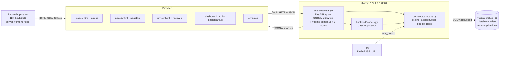

### Diagram 2 — Frontend-to-backend communication and page navigation

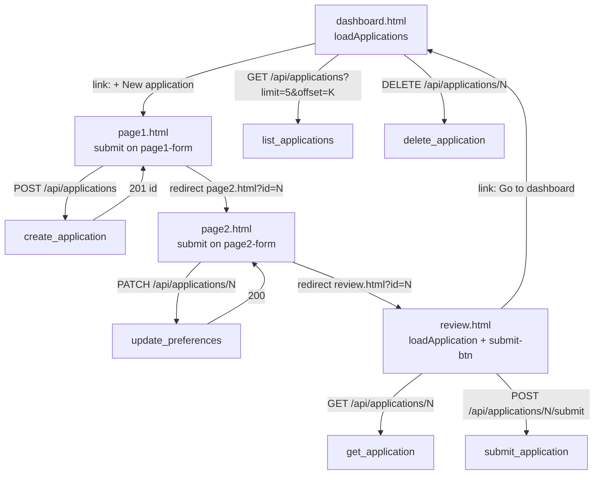

Key idea ✅: the only thing connecting page 1 → page 2 → review is the **`?id=N` in the URL**. HTTP is stateless.

### Diagram 3 — Backend-to-database communication (one request)

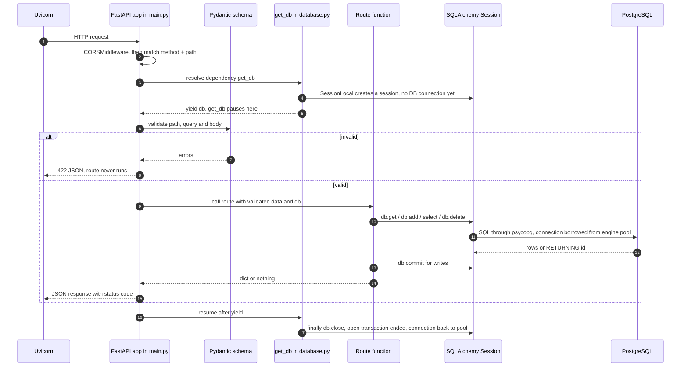

🔎 Two details here come from how FastAPI works internally, not from your code: (1) FastAPI resolves dependencies such as `get_db` **before** it validates the request body, so even a request that ends in 422 briefly creates a session — but it never touches PostgreSQL, because a session only borrows a connection when the first SQL is sent; (2) the code after `yield` (`db.close()`) runs after your route function has returned — in recent FastAPI versions such as yours (0.164), after the response has been sent. See §5 for the full step-by-step.

### Diagram 4 — Create (sequence)

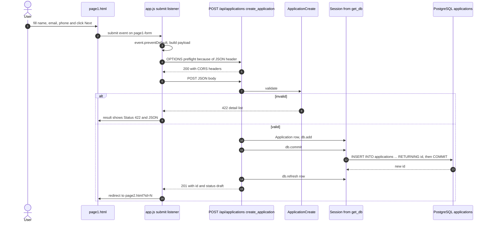

### Diagram 5 — Read (dashboard list, sequence)

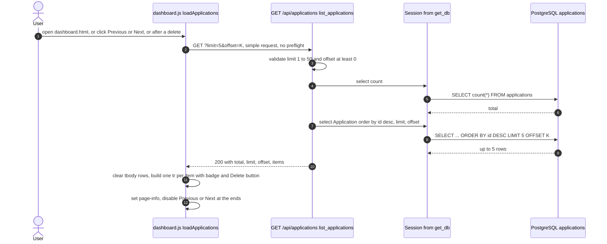

The **review page** reads one record the same way: `review.js loadApplication` → `GET /api/applications/{id}` → `get_application` → `db.get` → `SELECT ... WHERE id = N` → 200 or 404 → text in `#details`.

### Diagram 6 — Update (sequence: preferences, then submit)

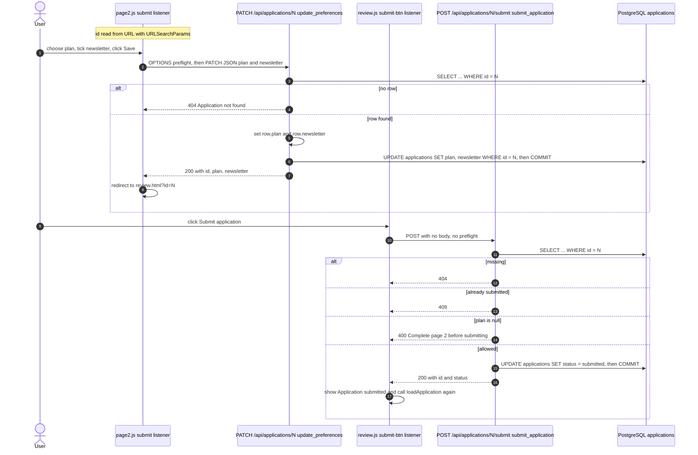

### Diagram 7 — Delete (sequence)

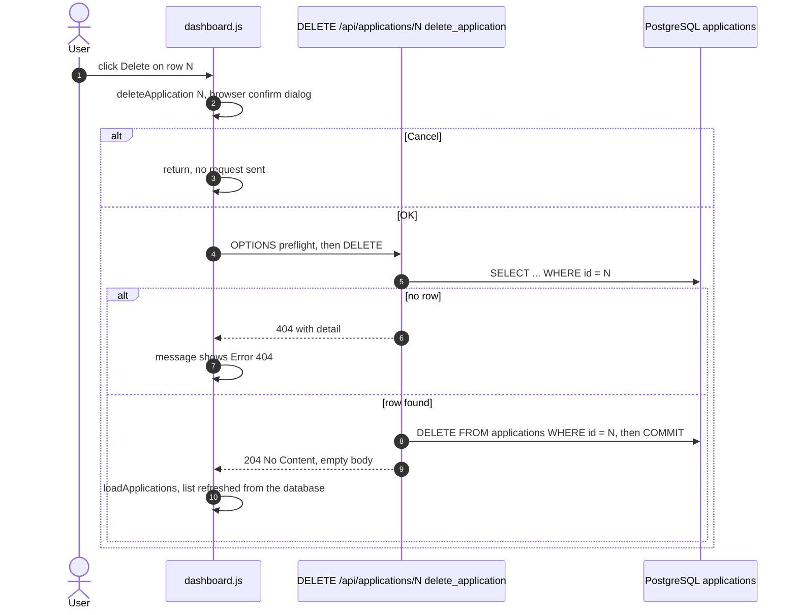

### Diagram 8 — Database schema (entity diagram)

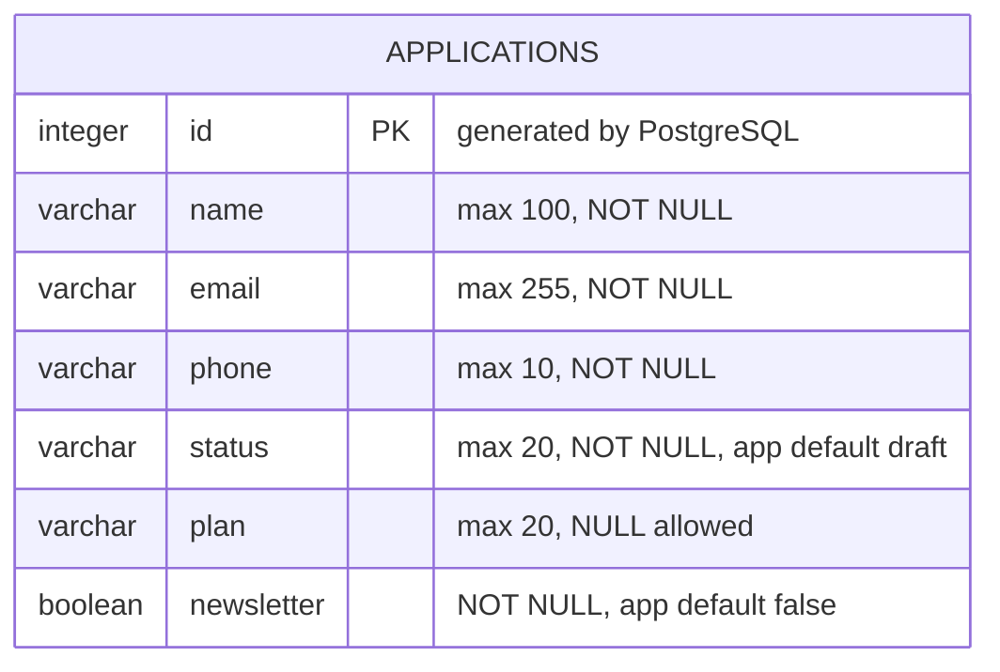

✅ One table only — **no relationships** (no foreign keys) exist in the project.

🔎 The DDL that `Base.metadata.create_all(engine)` generated for this model is approximately:

```sql
CREATE TABLE applications (
    id          SERIAL      NOT NULL,
    name        VARCHAR(100) NOT NULL,
    email       VARCHAR(255) NOT NULL,
    phone       VARCHAR(10)  NOT NULL,
    status      VARCHAR(20)  NOT NULL,
    plan        VARCHAR(20),
    newsletter  BOOLEAN      NOT NULL,
    PRIMARY KEY (id)
);
```

(Inferred from `models.py`; check the real definition with `\d applications` in psql. Note the `"draft"` / `False` defaults are applied by SQLAlchemy in Python, so they do **not** appear in the table definition.)

### Diagram 9 — Component and file dependency diagram

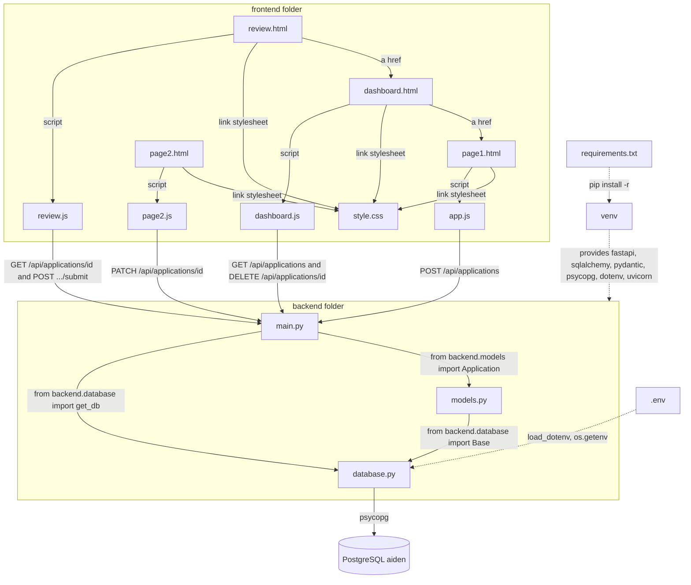

---

## 3. CRUD Execution Flows — in detail

### A. CREATE — the user fills page 1 and clicks **Next**

| Question | Answer (✅ unless marked) |
|---|---|
| Which HTML element triggers it? | `<button type="submit">Next</button>` inside `<form id="page1-form">` in `page1.html`. Clicking it (or pressing Enter) fires the form's **`submit`** event. |
| Which listener runs? | The anonymous `async (event) => {...}` registered with `form.addEventListener("submit", ...)` in `app.js` line 4. (There is no named function.) |
| How is data collected? | `document.getElementById("name").value`, `"email"`, `"phone"` → object `payload` (lines 6–10). First `event.preventDefault()` stops the browser's default page reload. |
| How is the request built? | `fetch("http://127.0.0.1:8000/api/applications", { method: "POST", headers: { "Content-Type": "application/json" }, body: JSON.stringify(payload) })` (lines 11–15). Because of the JSON header, the browser first sends an **OPTIONS preflight**, answered by `CORSMiddleware`. |
| Which endpoint receives it? | `@app.post("/api/applications", status_code=201)` — `main.py` line 29. |
| Which backend function executes? | `create_application(payload: ApplicationCreate, db: Session = Depends(get_db))` — line 30. |
| How is it validated? | **Before** the function runs, FastAPI parses the JSON and validates it against `ApplicationCreate` (lines 20–23): name 1–100 chars, `EmailStr`, phone `^\d{10}$`. Any failure → **422** with a `detail` list (`type`, `loc`, `msg`, `input`); the function never runs. |
| Which DB operation executes? | `row = Application(...)` (line 31, in memory only) → `db.add(row)` (32, staged) → `db.commit()` (33). 🔎 SQL logged by `echo=True`: `BEGIN`, `INSERT INTO applications (name, email, phone, status, plan, newsletter) VALUES (...) RETURNING applications.id`, `COMMIT`. |
| When is the record inserted and committed? | At **`db.commit()`** (line 33). Before that nothing is in PostgreSQL. `db.refresh(row)` (34) then reloads the row so `row.id` and `row.status` (`"draft"`) are available. |
| What response is returned? | `{"id": row.id, "status": row.status}` with status **201 Created** (line 35). |
| How does the frontend react? | `const data = await response.json()`; if `response.ok` → `window.location.href = \`page2.html?id=${data.id}\``; otherwise the error JSON is shown in `<p id="result">` (lines 16–21). |
| Does the dashboard update? | **Not directly.** There is no live connection. The dashboard shows the new row the next time `loadApplications()` runs (opening or refreshing `dashboard.html`), because it re-reads the database. Newest first (`ORDER BY id DESC`), so it appears at the top. |
| Error handling gap | `app.js` has **no `try`/`catch`**: if Uvicorn is down, `fetch` throws and the page shows nothing (Console: `TypeError: Failed to fetch`). |

### B. READ — the dashboard loads or refreshes

| Question | Answer |
|---|---|
| What triggers the request? | (1) Page load: `loadApplications();` at the bottom of `dashboard.js` (line 84). (2) Previous/Next click handlers (lines 74–82). (3) A successful delete (line 63). |
| Which JS function runs? | `async function loadApplications()` — `dashboard.js` lines 10–54. |
| Which endpoint is called? | `GET http://127.0.0.1:8000/api/applications?limit=5&offset=<offset>` (`LIMIT = 5`, `offset` starts at 0). No headers or body → a **simple** request → **no preflight**. |
| Which backend function? | `list_applications(limit, offset, db)` — `main.py` lines 71–85. `Query(5, ge=1, le=50)` and `Query(0, ge=0)` validate the query parameters (e.g. `limit=100` → 422). |
| What SQL / ORM operation? | `db.scalar(select(func.count()).select_from(Application))` → 🔎 `SELECT count(*) FROM applications`; `db.scalars(select(Application).order_by(Application.id.desc()).limit(limit).offset(offset)).all()` → 🔎 `SELECT applications.id, ... FROM applications ORDER BY applications.id DESC LIMIT 5 OFFSET 0`. No commit (read-only). |
| How are results converted? | A **list comprehension** builds one dict per row with 5 fields (`id, name, email, plan, status`), wrapped in `{"total", "limit", "offset", "items"}`. FastAPI converts it to JSON. |
| How are records displayed? | `message.textContent = "<total> application(s)"`; `rowsEl.textContent = ""` clears old rows; for each item: `createElement("tr")`, 4 `<td>` text cells (`plan ?? "-"`), a `<span class="badge badge-<status>">`, and a `<button class="btn-danger">Delete</button>` wired to `deleteApplication(app.id)`; then `Page X of Y` and disabling Previous (`offset === 0`) / Next (`offset + LIMIT >= total`). Values use `textContent`, so user input is never executed as HTML. |
| Read one (review page) | `review.js` `loadApplication()` → `GET /api/applications/{id}` → `get_application` → `db.get(Application, id)` → 🔎 `SELECT ... WHERE applications.id = %(pk)s` → 200 (7 fields) or 404 → shown as text lines in `#details`. |

### C. UPDATE — there is **no "Edit" button on the dashboard**

✅ Verified: the dashboard rows have only a **Delete** action. Updates happen in two places of the multi-page flow:

**C1. Preferences (`PATCH`) — page 2**

1. **How the record is identified:** the id travels in the URL. `app.js` redirected to `page2.html?id=N`; `page2.js` line 1–2: `new URLSearchParams(window.location.search).get("id")`.
2. **Trigger:** `<button type="submit">Save</button>` in `<form id="page2-form">` → `submit` listener in `page2.js` line 9.
3. **Data:** `plan: document.getElementById("plan").value` (`"basic"`/`"pro"`), `newsletter: document.getElementById("newsletter").checked` (`true`/`false` — **not** `.value`).
4. **Request:** `fetch(\`http://127.0.0.1:8000/api/applications/${id}\`, { method: "PATCH", headers: JSON, body })` inside `try` (lines 15–30). Preflight: yes (PATCH + JSON).
5. **Endpoint:** `@app.patch("/api/applications/{application_id}")` → `update_preferences` (`main.py` 37–46). `application_id: int` is taken from the path (`"abc"` → 422); body validated by `ApplicationPreferences` (`"gold"` → 422).
6. **DB:** `db.get(Application, application_id)` (🔎 SELECT) → `None` → `HTTPException(404)`; otherwise set `row.plan`, `row.newsletter` → `db.commit()` → 🔎 `UPDATE applications SET plan=..., newsletter=... WHERE applications.id = ...` + `COMMIT`. No `db.add` needed: the session already tracks the row.
7. **Response:** 200 `{id, plan, newsletter}` → `page2.js` redirects to `review.html?id=N`.
8. **"Refreshing the dashboard":** as with Create, the dashboard shows the new plan the next time it loads.

**C2. Status (`draft → submitted`) — review page**

1. Trigger: `#submit-btn` click listener in `review.js` line 24.
2. Request: `POST /api/applications/${id}/submit` with no body/headers (simple request).
3. Endpoint: `submit_application` (`main.py` 58–69): 404 if missing → 409 if already submitted → 400 if `plan is None` → `row.status = "submitted"` → `db.commit()` (🔎 `UPDATE applications SET status='submitted' WHERE id = ...`).
4. Response: 200 `{id, status}` → `review.js` shows "Application submitted." and calls `loadApplication()` again so the displayed status comes **from the database**.

**Not updatable (verified):** `name`, `email`, `phone` — no endpoint changes them after creation.

### D. DELETE — the user clicks **Delete** on a dashboard row

| Step | Detail |
|---|---|
| Event listener | Created per row inside `loadApplications()`: `deleteBtn.addEventListener("click", () => deleteApplication(app.id))` (`dashboard.js` line 40). The arrow function **remembers this row's `app.id`** — that is how the right record is chosen. |
| Function | `async function deleteApplication(id)` (lines 56–72). |
| Confirmation | `if (!confirm(...)) return;` — Cancel → no request at all. |
| API request | `fetch(\`http://127.0.0.1:8000/api/applications/${id}\`, { method: "DELETE" })`. Preflight: yes (DELETE is not a "simple" method). |
| Endpoint | `@app.delete("/api/applications/{application_id}", status_code=204)` → `delete_application` (`main.py` 87–93). |
| DB operation | `db.get` (🔎 SELECT) → 404 if missing → `db.delete(row)` (marks for deletion) → `db.commit()` → 🔎 `DELETE FROM applications WHERE applications.id = ...` + `COMMIT`. |
| Response | **204 No Content** — empty body. |
| Frontend update | `if (response.ok) loadApplications();` — the table is rebuilt from a fresh GET, so the row disappears because the **database** no longer has it. `.json()` is only called in the error branch (a 204 has no body; calling `.json()` would throw). |
| Hard or soft delete? | ✅ **Hard delete.** `db.delete(row)` physically removes the row. There is no `deleted`, `deleted_at` or `is_active` column, and no filtering of "deleted" rows. Once deleted, the data is gone (unless restored from a database backup). |
| Known edge case | Deleting the only row on the last page leaves `offset` unchanged → an empty page is shown; Previous still works. |

---

## 4. Where to watch each flow

| Where | What you see | Example |
|---|---|---|
| Browser DevTools → **Network** | Each request: method, URL, status, Payload, Response, Headers; OPTIONS preflights for POST-with-JSON, PATCH, DELETE | `PATCH /api/applications/7 200` |
| Browser DevTools → **Console** | JS errors (`TypeError: Failed to fetch`, `ReferenceError`, CORS messages) | Turn on ⚙ **Preserve log** to keep errors across page reloads |
| Uvicorn terminal | Request log lines + SQL (from `echo=True`) + Python tracebacks | `INFO: 127.0.0.1:55098 - "POST /api/applications HTTP/1.1" 201 Created` |
| http.server terminal | Which static files were served | `"GET /dashboard.js HTTP/1.1" 200 -` |
| psql | The rows actually stored | `SELECT * FROM applications ORDER BY id DESC;` |
| `http://127.0.0.1:8000/docs` | Call any endpoint without the frontend | Try it out → Execute |

---

## 5. Deep dive — one `POST /api/applications`, function by function, and how the session works

This follows a single click on **Next** on page 1 through every file, and tracks the **SQLAlchemy session** at each moment.

### 5.1 Four words you need first

| Thing | Created where | How long it lives | Analogy |
|---|---|---|---|
| **Engine** | `database.py` line 11, **once** when the server starts | Whole server lifetime | The restaurant's account with the supplier — set up once |
| **Connection pool / connection** | Inside the engine | A connection is **borrowed** only while SQL runs, then returned to the pool for reuse | A few phone lines to the storeroom, shared by everyone |
| **Session** (`db`) | `get_db()` → `SessionLocal()` (`database.py` lines 16, 19), **once per request** | One request | A fresh notepad for one order: it remembers which objects you added or changed |
| **Transaction** | Started automatically by the session the first time it talks to the DB | From `BEGIN` until `COMMIT` (save) or `ROLLBACK` (discard) | One order slip: nothing is final until it's signed (`COMMIT`) |

### 5.2 Before the request: Uvicorn has already loaded your files

`main.py` imported `database.py` (engine created, **no connection yet**) and `models.py` (`Application` registered). See the walkthrough §3.0 for the start-up import order. Only the **request** part is shown below.

### 5.3 The request, step by step

Labels: ✅ visible in your code · 🔎 library behaviour (FastAPI / SQLAlchemy / browser) that is not visible in your code.

| # | File → function (line) | What happens | Session / database state |
|---|---|---|---|
| 0 | `app.js` → submit listener (4–15) ✅ | `event.preventDefault()`, builds `payload`, calls `fetch(..., {method: "POST", headers: {"Content-Type": "application/json"}, body})`. 🔎 Because of the JSON header the browser first sends an **OPTIONS** preflight; `CORSMiddleware` (`main.py` 12–17) answers it by itself. | No route runs, **no session** |
| 1 | Uvicorn 🔎 | Receives the real POST on port 8000, parses the HTTP, hands it to the `app` object from `main.py`. | — |
| 2 | `main.py` → `CORSMiddleware` (12–17) ✅ | Checks the `Origin: http://127.0.0.1:5500` header is allowed and passes the request inward. | — |
| 3 | FastAPI router 🔎 → `main.py` line 29 ✅ | Matches **POST + `/api/applications`** → `create_application`. Reads its parameters: `payload: ApplicationCreate` (from the body) and `db: Session = Depends(get_db)` (a dependency). | — |
| 4 | `database.py` → `get_db()` (18–21) ✅ | 🔎 FastAPI resolves the dependency **first**: `db = SessionLocal()` creates a session, then `yield db` hands it over and **pauses** `get_db` right there. FastAPI runs this plain `def` generator in a worker thread. | Session **exists**, but **no connection, no transaction** yet |
| 5 | `main.py` → `ApplicationCreate` (20–23) ✅ | FastAPI parses the JSON and Pydantic validates it. **If invalid →** 422 response, `create_application` never runs, `get_db` resumes and `db.close()` runs — **nothing was ever sent to PostgreSQL.** | Unchanged |
| 6 | `main.py` → `create_application` line 31 ✅, using `models.py` `Application` | `row = Application(name=..., email=..., phone=...)` — just a Python object. `status`, `newsletter`, `id` are not set yet. | `row` is **transient** (the session doesn't know it) |
| 7 | line 32 `db.add(row)` ✅ | The session now tracks `row`. 🔎 Still **no SQL sent**. | `row` is **pending** |
| 8a | line 33 `db.commit()` → flush 🔎 | The session needs the database now, so it **borrows a connection** from the engine's pool (psycopg connects to `localhost:5432` database `aiden`, or reuses an open connection). Log: `BEGIN (implicit)`. | Connection borrowed, **transaction open** |
| 8b | flush continues 🔎 | SQLAlchemy fills the Python-side defaults from `models.py` (`status="draft"`, `newsletter=False`) and sends `INSERT INTO applications (...) VALUES (...) RETURNING applications.id`. PostgreSQL stores the row and returns the new id N; SQLAlchemy puts it in `row.id`. | `row` is **persistent** (has a database identity) — but not yet permanent |
| 8c | commit finishes 🔎 | Sends `COMMIT` → the row is now **permanently saved**. The connection goes **back to the pool**. All of `row`'s attributes are marked **expired** (SQLAlchemy's default `expire_on_commit=True`), meaning "re-read before trusting them". | Transaction **closed**, no connection held |
| 9 | line 34 `db.refresh(row)` ✅ | 🔎 A new transaction begins automatically, a connection is borrowed again, and `SELECT applications.id, applications.name, ... WHERE applications.id = N` reloads every column. | Transaction **open again** (read-only) |
| 10 | line 35 `return {"id": row.id, "status": row.status}` ✅ | A plain dict, e.g. `{"id": 12, "status": "draft"}`. | Unchanged |
| 11 | FastAPI 🔎 → back through `CORSMiddleware` → Uvicorn | The dict becomes JSON, status **201** (from `status_code=201` on line 29), the CORS header `access-control-allow-origin` is added, and the bytes are sent. Uvicorn logs `"POST /api/applications HTTP/1.1" 201 Created`. | Unchanged |
| 12 | `database.py` → `get_db()` `finally: db.close()` (22–23) ✅ | 🔎 FastAPI resumes `get_db` after the `yield`. `close()` ends the read-only transaction from step 9 with `ROLLBACK` (nothing to undo — the INSERT was already committed in 8c), returns the connection to the pool, and forgets all objects. | Session **closed**, `row` **detached** |
| 13 | `app.js` (16–21) ✅ | `await response.json()` → `{id: 12, status: "draft"}`; `response.ok` is true → `window.location.href = "page2.html?id=12"`. | — |

**In one sentence:** the session is opened by `get_db` before your function runs, collects your changes in memory (`add`), sends them to PostgreSQL and makes them permanent at `commit`, re-reads the row at `refresh`, and is closed by `get_db` after your function has returned.

### 5.4 Sequence diagram of the same journey

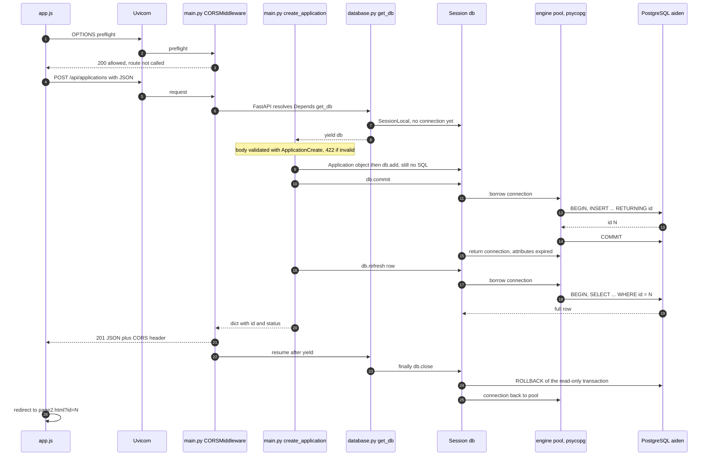

### 5.5 The life of `row` inside the session

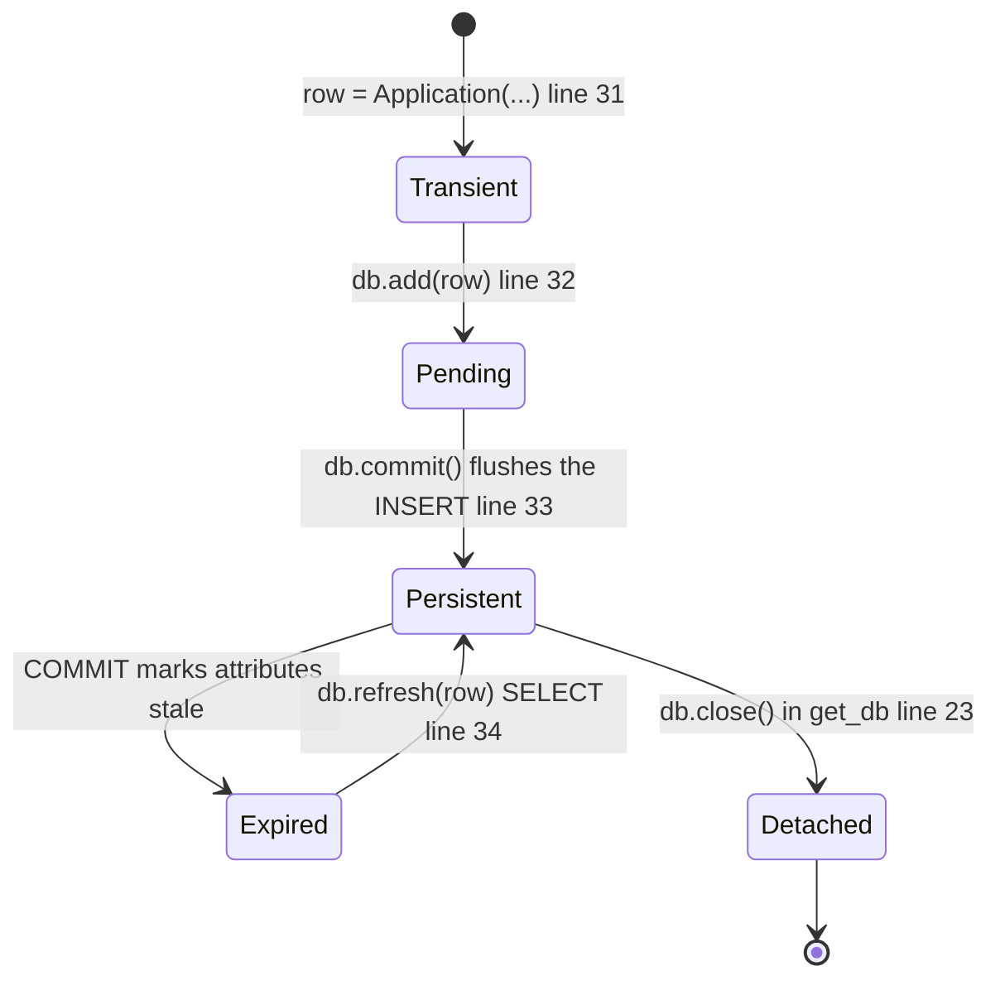

"Expired" isn't a separate official SQLAlchemy state — the object is still persistent, it just knows its values must be re-read. Accessing `row.id` after the commit would trigger that re-read automatically even without `refresh`; the explicit `refresh` makes it obvious.

### 5.6 Confirm it yourself in the Uvicorn terminal

Thanks to `echo=True` (`database.py` line 11) you can watch steps 8–12. After one valid submit you should see roughly this (🔎 timestamps, parameter formatting and the order of the last two lines can vary slightly):

```text
INFO:     127.0.0.1:XXXXX - "OPTIONS /api/applications HTTP/1.1" 200 OK          ← step 0
... INFO sqlalchemy.engine.Engine BEGIN (implicit)                                ← step 8a
... INFO sqlalchemy.engine.Engine INSERT INTO applications (name, email, phone, status, plan, newsletter)
        VALUES (%(name)s, %(email)s, ...) RETURNING applications.id               ← step 8b
... INFO sqlalchemy.engine.Engine [generated in ...] {'name': 'Asha', 'email': ..., 'status': 'draft', ...}
... INFO sqlalchemy.engine.Engine COMMIT                                           ← step 8c
... INFO sqlalchemy.engine.Engine BEGIN (implicit)                                 ← step 9
... INFO sqlalchemy.engine.Engine SELECT applications.id, applications.name, ...
        FROM applications WHERE applications.id = %(pk_1)s                         ← step 9
... INFO sqlalchemy.engine.Engine ROLLBACK                                         ← step 12
INFO:     127.0.0.1:XXXXX - "POST /api/applications HTTP/1.1" 201 Created         ← step 11
```

After an **invalid** submit (e.g. empty phone) you should see only the `OPTIONS` line and `"POST /api/applications HTTP/1.1" 422 Unprocessable Content` — **no SQL at all**, proving that validation stopped the request before any database work.

### 5.7 What if something goes wrong mid-way?

| Failure | Where | What happens to the session and data |
|---|---|---|
| Invalid body | Step 5 | 422; session created and closed; no SQL sent |
| PostgreSQL stopped / wrong password | Step 8a (first time a connection is needed) | Exception → **500**; `get_db`'s `finally` still closes the session. In the browser the 500 shows up as a CORS error + `TypeError: Failed to fetch`, and because `app.js` has no `try`/`catch` the page stays silent |
| `INSERT` rejected (e.g. table missing → `relation "applications" does not exist`) | Step 8b | Exception → 500; the transaction never reached `COMMIT`, so **no partial row is saved**; `close()` rolls it back |
| Crash after the commit (e.g. a bug on line 35) | Step 10 | 500 — but the row **is** already saved (it was committed in 8c). That's why commits should happen only when everything that must be saved together is ready |

### 5.8 Why the code is written this way

- **One session per request (`Depends(get_db)`):** two users submitting at the same time get separate sessions, so their changes never mix.
- **`yield` instead of `return` in `get_db`:** lets cleanup (`db.close()`) run *after* the route, and `finally` guarantees it even when the route crashes — otherwise connections would leak until PostgreSQL refuses new ones.
- **`db.add` doesn't write, `db.commit` does:** you can stage several changes and save them all-or-nothing in one transaction.
- **`db.refresh`:** fetches what the *database* produced (the generated `id`) so the response tells the browser the real id to carry to page 2.
